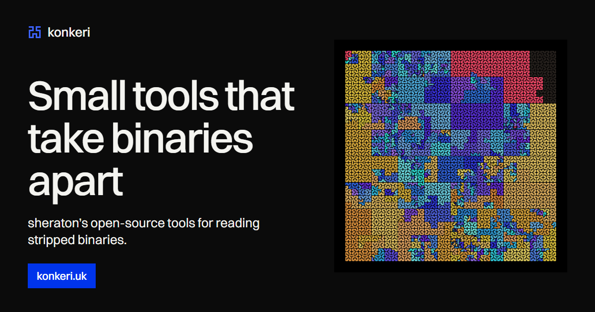

<p align="center"><a href="https://konkeri.uk"></a></p>

# konkeri.uk

The source of [konkeri.uk](https://konkeri.uk), my CV and project index: small tools that take binaries apart, each shown by its own real output.

- **Live from GitHub.** The Worker reads my repositories and releases from the GitHub API, caches them at the edge for an hour, and falls back to the last complete copy, then to a saved snapshot, if the API is rate-limited. The page falls back to the same snapshot if it can't reach the Worker.
- **The tools** are a plain list; pointing at one shows a real run of it. On a phone, tapping a tool opens its run underneath.
- **The map** is a real [unwind-map](https://github.com/sheratonc/unwind-map) map of a stripped binary, with working controls: hide functions under a size, keep only the ones with landing pads, mark the code with no unwind info. Pointing, tapping or the arrow keys read out each function's address range and size.
- **Releases** are listed by day with a month calendar built from the same data.
- **Two themes,** paper and ink, chosen from the system setting or the toggle.
- **One typeface,** Switzer (Indian Type Foundry, ITF Free Font License), self-hosted in `public/fonts`.
- **Strict by default.** No frameworks, no client-side JavaScript dependencies, no inline scripts or styles, and a `default-src 'self'` Content Security Policy on every response.

The die photographs in the first screen (`public/img`) are by Pauli Rautakorpi, CC BY 3.0, via Wikimedia Commons; `public/img/credits.json` lists each source.

## Layout

| Path | What it is |
| --- | --- |
| `src/index.ts` | The Worker: canonical-host and HTTPS redirects, the cached `/api/github` endpoint, security headers |
| `src/main.ts` | The page script: the tool previews, the map and its controls, the release list and calendar, the hero crossfade |
| `src/style.css` | All styles, with one set of colour tokens for both themes |
| `src/outputs.ts` | Real output from each tool, shown in the tool previews |
| `src/github-snapshot.json` | The fallback GitHub data, written by `npm run snapshot` |
| `index.html`, `public/` | The page, the 404 page, the map, fonts, photographs, icons and the social card |
| `scripts/` | The snapshot script, and the source of the social card (`og.html`, captured to `public/og.png`) |
| `cloudflare.config.ts` | The Worker's configuration for the `cf` CLI: bindings, assets and custom domains |

## Working on it

```sh
npm install
npm run build      # build the Worker and the static assets
npm run preview    # serve the production build locally
npm run typecheck  # type-check the Worker and the page script
npm run snapshot   # refresh the fallback GitHub data
npm run deploy     # build and deploy to Cloudflare
```

`npm run preview` is the faithful local view: the dev server injects styles inline, which the site's own Content Security Policy blocks.

The Worker reads GitHub with an optional `GITHUB_TOKEN` secret, a read-only token for public repositories that raises the API limit from 60 to 5,000 requests an hour. It's set in the Cloudflare dashboard and declared in `cloudflare.config.ts`, so deploys keep it.

## Licence

All rights reserved. This code is published to be read, not reused; see [LICENSE](LICENSE).
